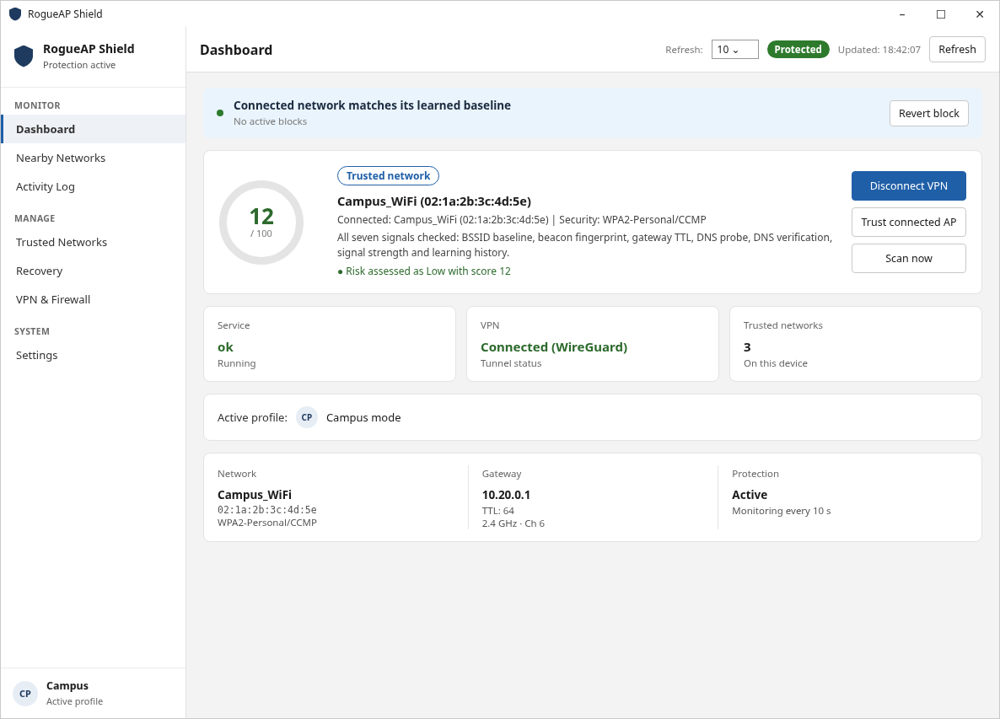
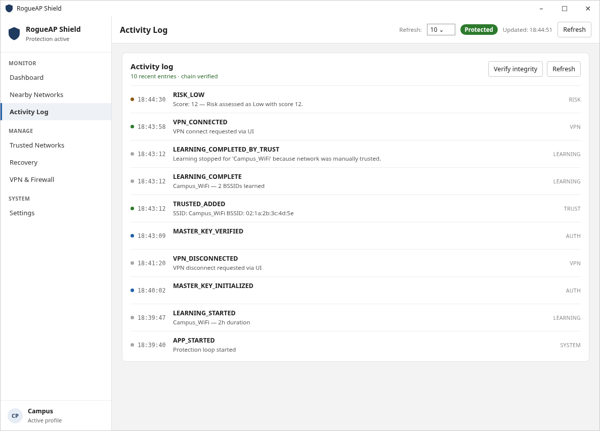

# RogueAP Shield

**Real-time "evil twin" Wi-Fi detection for Windows laptops.** C# / .NET 9, 2026.

RogueAP Shield runs as a Windows service, checks every Wi-Fi network you join against seven independent signals, and reacts when one looks like a rogue access point: it warns you, brings up your VPN, or blocks traffic until the VPN is up.



*Mockup of the real dashboard with a demo network.*

## The problem

An attacker with a phone hotspot can copy a café's or campus's network name (SSID) and even its MAC address. Laptops join it automatically, and from then on the attacker sits in the middle of the traffic. Checking the name or a single MAC isn't enough; the fake has to be caught by several things that are hard to fake at once.

## Design

```
Windows Native Wi-Fi scan ─► 7 detection signals ─► weighted risk score ─► policy ─► action
                                                     (low/medium/high/critical)   alert · VPN up · block
```

**The seven signals:** BSSID baseline match, 802.11 beacon fingerprint, gateway TTL anomaly, DNS resolution probe, DNS verification, signal-strength outlier, and network-learning history.

| Project | Role |
|---|---|
| `RogueAP.Core` | Models, interfaces and the policy engine |
| `RogueAP.Infrastructure` | Wi-Fi scanner, risk analyser, DNS probes, VPN integration, encrypted storage, audit log |
| `RogueAP.Service` | Windows service running protection cycles; localhost control API on `127.0.0.1:5088` |
| `RogueAP.Gui` | WPF control panel: live status, trusted networks, VPN, keys, settings |
| `RogueAPShield-Setup.iss` | Inno Setup script that builds the installer and registers the service (build `publish/` first) |

**Auto-learning mode** baselines trusted networks at home, at work or on campus, so nobody has to whitelist BSSIDs by hand.

## What is secured, and how

- **Encrypted local data.** Trusted-network profiles are encrypted with AES-256-GCM. A data-encryption key (DEK) is wrapped by a key-encryption key derived from the user's master key with PBKDF2-SHA256.
- **Tamper-evident audit log.** Every event is SHA-256 hash-chained to the previous one, so a deleted or edited entry is detected.
- **VPN kill switch.** When risk is high and the VPN fails to connect, outbound traffic is blocked using Windows Firewall rules (Windows Filtering Platform).
- **Hardened command execution.** VPN connect/disconnect commands are checked against blocked tokens and run with time-outs and retries.
- **Safe by default.** `Enforcement.DryRun=true` until you deliberately switch it off.
- **Control API on localhost only**; changes to trusted networks or VPN settings need the master key.
- **Portable admin profiles** (`.rapf`) exported with AES-256-GCM.

## Testing

- A live evil-twin attack recreated with a mobile hotspot.
- Multi-AP testing across 53 access points on a university campus network.
- All 15 functional and 7 non-functional requirements met.

## Run it

Needs Windows 10/11 and the .NET 9 SDK.

```powershell
dotnet build RogueAP.sln
dotnet run --project src/RogueAP.Service/RogueAP.Service.csproj   # start the service first
dotnet run --project src/RogueAP.Gui/RogueAP.Gui.csproj           # then the control panel
```

Keep `Enforcement.DryRun=true` in `src/RogueAP.Service/appsettings.json` while testing. If a block rule is ever left behind:

```powershell
netsh advfirewall firewall delete rule name="RogueAP_BlockAllOutbound"
```

## Screenshots

Activity log with the hash-chain "Verify integrity" check (mockup with demo data):



Built by Chaitanya Dhotre.
